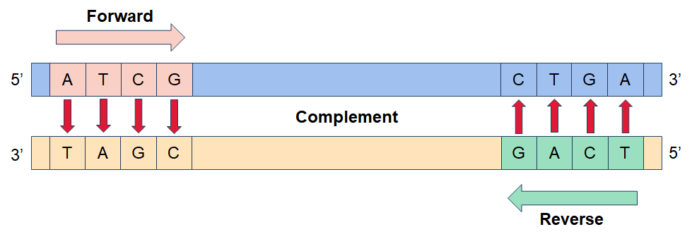
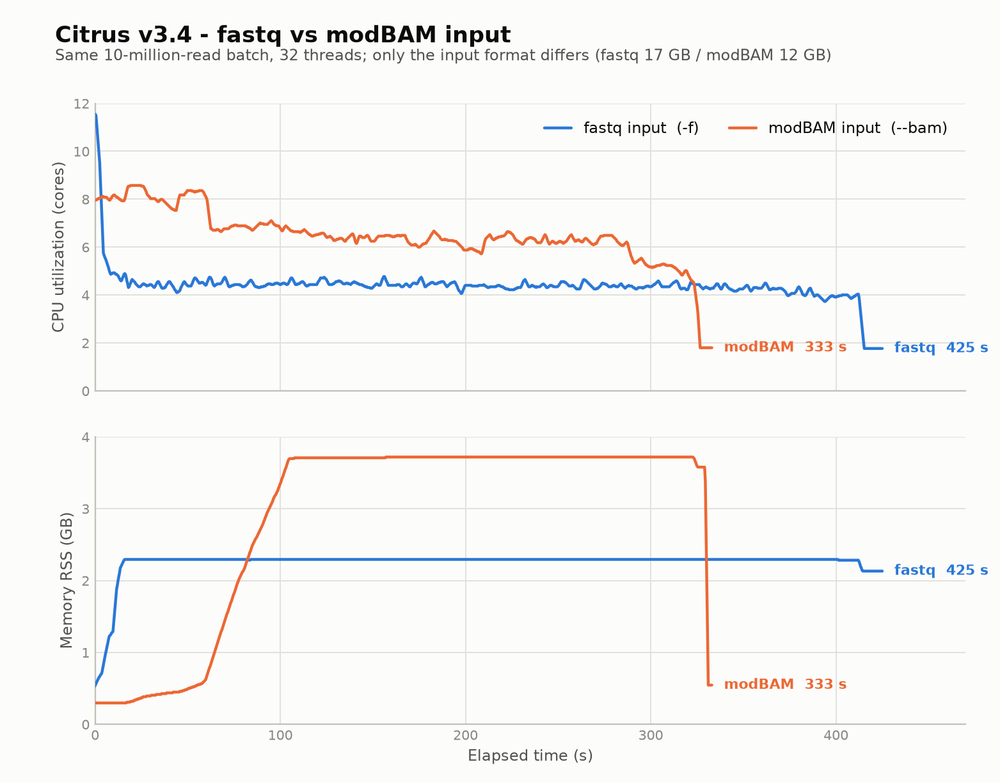
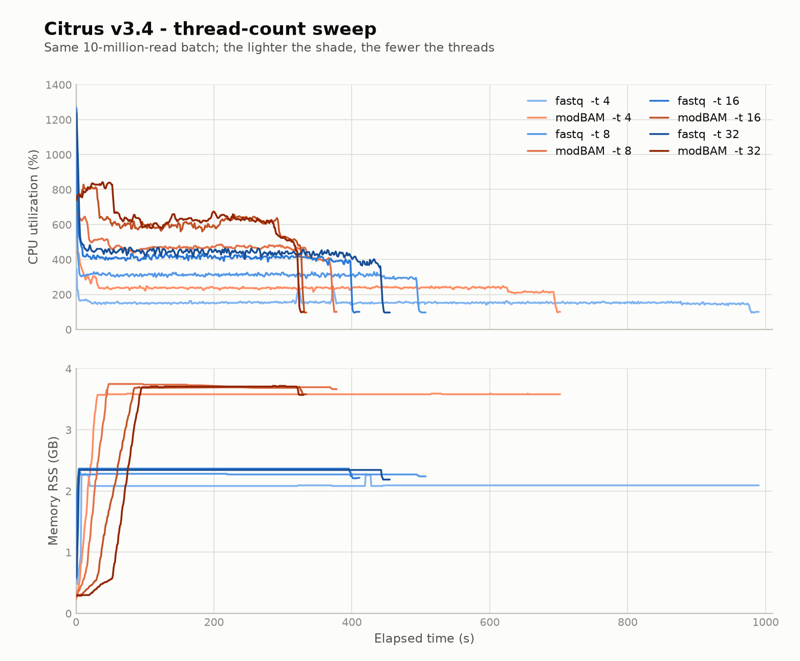

# Citrus
This tool is designed to efficiently demultiplex barcodes from sequencing data. It streamlines the preprocessing of genomic data by demultiplexing barcodes, enhancing the accuracy of downstream analyses.

## No Installation Required  
**Ready to Use After Extraction**  

This software is designed for ease of use without the need for a complicated installation process. Simply extract the contents of the software package to your preferred location on your system, and it's ready to go.  

**How to Start:**  
1. Download the `.tar.gz` file that matches your CPU architecture (`x86_64` or `aarch64`).
2. Extract the contents to a desired location.  
3. Run the `citrus` to start the software.  

The release binaries are dynamically linked against glibc and require glibc 2.28 or later on the host (RHEL 8/9, Rocky 8/9, Debian 10+, Ubuntu 20.04+, ARM servers). No other external dependency is needed.  

## Example Usage  
**Mode 1 barcode demultiplexing**  
```bash
citrus -m 1 -f sample.fq.gz -b barcodes.txt -o output_dir -n sample -e 0.2 -s 150,100 -t threads
```
**Mode 2 barcode demultiplexing**  
```bash
citrus -m 2 -f sample.fq.gz -b barcodes.txt -o output_dir -n sample -e 0.2 -s 150,100 -t threads
```
**Multiple input files**  
```bash
citrus -m 1 -f sample1.fq.gz sample2.fq.gz -b barcodes.txt -o output_dir -n sample
```
**BAM input**  
Unmapped BAM files carrying MM/ML tags are accepted; all other tags are passed through unchanged.  
```bash
citrus -m 1 --bam sample.bam -b barcodes.txt -o output_dir -n sample
```
**Predefined barcode kit**  
```bash
citrus -m 2 -f sample.fq.gz -k CycloneSEQ_24_Barcode_Library_Prep_Set -o output_dir -n sample
```

## Command-line Arguments  
| Name | Description | Required | Default |
| :---: | --- | :---: | :---: |
| `-m, --mode` | Set a mode to demultiplex barcodes. 1: demultiplex the 5' end barcode and conditionally demultiplex the 3' end barcode if identified; 2: demultiplex barcodes at both the 5' and 3' ends | Yes | - |
| `-f, --fastq` | Input one or more fastq files, separated by spaces | Yes¹ | - |
| `--bam` | Input one or more unmapped BAM files carrying MM/ML tags, separated by spaces | Yes¹ | - |
| `-k, --kits` | Use a predefined barcode kit. Mutually exclusive with `-b` | Yes² | - |
| `-b, --barcode` | Input one or more barcode files. If there are both-ends barcodes in a read, please separate them with a tab in the input file. When both-ends barcodes complement each other in reverse, only the 5' end barcode is needed. For reads with two barcodes on one end, the barcode files should be comma-separated | Yes² | - |
| `-n, --sample` | Sample name | Yes | - |
| `-t, --thread` | Number of threads | No | 4 |
| `-o, --outdir` | Output directory | Yes | - |
| `-q, --testseq` | Input a test sequence file | No | - |
| `-L, --min_len` | Sequences shorter than the minimum length are discarded while reading input: not written to any file and not counted in the statistics. Before v3.3.0 such reads were written to `{sample}.length_filtered.fq.gz` | No | 0 |
| `-Q, --min_qual` | Reads whose quality computed from the base qualities (`-10·log10(mean(10^(-Q_i/10)))`, not the read-ID qscore) is lower than the minimum are discarded | No | 7.0 |
| `-e, --err` | Threshold of Levenshtein Distance value (integer) or sequencing error rate (float value between 0 and 1). Use a comma to separate two numbers, when there are different thresholds for the 5' and 3' ends | No | 0.2,0.2 |
| `-s, --shift` | Threshold of shift length for identifying barcode sequences. Use a comma to separate two numbers, when there are different thresholds for the 5' and 3' ends | No | 150,100 |
| `-u, --trim_len` | Set trimmed length for barcode recognition when 3' end sequencing is incomplete | No | 0 |
| `-c, --seed_size` | Seed size | No | 6 |
| `-d, --step_size` | Step size | No | 1 |
| `-r, --retain` | Retain barcode sequences on reads | No | - |
| `-g, --degenerate` | Allow degenerate bases in barcodes and primers | No | - |
| `-i, --intermediate` | Output intermediate results | No | - |
| `-F, --filter_chimeric` | Filter chimeric reads | No | - |
| `-a, --append` | Append to existing output files instead of overwriting them | No | - |
| `-h, --help` | Print help | No | - |
| `-V, --version` | Print version | No | - |

¹ Either `--fastq` or `--bam` is required; the two are mutually exclusive.  
² Either `--barcode` or `--kits` is required; the two are mutually exclusive.

**Note on defaults:** when a predefined kit is used with `-k`, the kit's tuned parameters replace the defaults listed above. Parameters you set explicitly on the command line always take precedence.

## Barcode File
The barcode file must contain two or three tab-separated columns: `ID`, `5' barcode sequence`, and optionally `3' barcode sequence`. The `ID` can be the number of a barcode, or names like sample name, species name, or tissue name, etc. Additionally, one `ID` can correspond to multiple pairs of barcode sequences.  
As shown in the example, if the `ID` is `BC1`, the barcode file would be structured as follows:  
<table><tr><td>BC1</td><td>ATCG</td><td>TCAG</td></tr></table>



**Single-end barcodes** — one barcode per line; the same sequence is used for both ends:

```
barcode_id	barcode_sequence
BC01	ATCGATCG
BC02	GCTAGCTA
```

**Dual-end barcodes** — two barcodes per line:

```
barcode_id	5p_barcode	3p_barcode
BC01	ATGC	GGTA
BC02	TTGCATCA	CCTAGGTA
```

When the 5' and 3' adapters are different, put both adapters for the same barcode ID on one line. Citrus automatically recognizes both sequencing orientations for that adapter pair. For example:

```
BC01	ATGC	GGTA
```

This configuration matches forward reads such as:

```
5' ATGC ... TACC 3'
```

where `TACC` is the reverse complement of `GGTA`. It also matches the opposite orientation:

```
5' GGTA ... GCAT 3'
```

where `GCAT` is the reverse complement of `ATGC`. Both orientations are written to the `BC01` output. Use `--mode 2` when both the 5' and 3' adapters must be detected; use `--mode 1` when reads may be classified by the 5' adapter only.

**Avoid mirrored pairs.** If the 5' and 3' adapters are drawn from one shared pool and every combination is listed, the pairs `(i, j)` and `(j, i)` are duplicates:

```
barcode_id	5p_barcode	3p_barcode
LB1_LB1	ATCGATCG	ATCGATCG
LB1_LB2	ATCGATCG	GCTAGCTA
LB2_LB2	GCTAGCTA	GCTAGCTA
LB2_LB1	GCTAGCTA	ATCGATCG
```

Citrus recognizes both sequencing orientations of every adapter pair, so `LB1_LB2` and `LB2_LB1` end up with exactly the same matching rule. A read carries one adapter at each end, and the adapter pair `ATCGATCG` / `GCTAGCTA` cannot be told apart from the mirrored pair `GCTAGCTA` / `ATCGATCG`, so the reads of both IDs are written to whichever ID sorts first by name while the mirrored ID stays empty. No warning is emitted.

> **Note.** List only one of the two orderings, e.g. every `i <= j` combination (N(N+1)/2 IDs for N barcodes: 300 for a 24-barcode pool, 4656 for a 96-barcode pool). Reads of either orientation are then reported under that single ID.
>
> Listing all combinations also repeats each 5' adapter across many IDs, so a read ends up with many equally good 5' candidates. In `--mode 1` this disables the fallback that classifies a read by its 5' adapter alone, and reads whose 3' adapter cannot be matched are discarded as LD-filtered. Use `--mode 2` for this layout.

## Predefined Barcode Kits
Use `-k` instead of `-b` to demultiplex with a built-in barcode kit:

| Kit | Alias | Barcodes |
| :---: | --- | :---: |
| `CycloneSEQ_24_Barcode_Library_Prep_Set` | `24_Ligation_Barcodes` | 24 |
| `CycloneSEQ_96_Barcode_Library_Prep_Set` | `96_Ligation_Barcodes` | 96 |
| `CycloneSEQ_Rapid_24_Barcode_Library_Prep_Set` | - | 24 |

Each kit carries its own tuned parameter set, and these values are the **effective defaults** when `-k` is used; without `-k` (custom `-b` file), the standalone defaults in the argument table above apply. Parameters you set explicitly always take precedence over either. The three kits share the same parameter set:

| Parameter | Kit value (effective with `-k`) | Standalone default (effective with `-b`) |
| :--- | :---: | :---: |
| `--err` | `0.25,0.25` | `0.2,0.2` |
| `--shift` | `150,100` | `150,100` |
| `--seed_size` | 6 | 6 |
| `--step_size` | 1 | 1 |
| `--min_len` | 0 | 0 |
| `--min_qual` | 7.0 | 7.0 |
| `--trim_len` | 6 | 0 |

The only differences between the two default sets are a relaxed error threshold (`--err`) and a 6 bp trim for barcode recognition when 3' end sequencing is incomplete (`--trim_len`). Note that `--help` always shows the standalone defaults; they are not the effective values under `-k`.

## How Demultiplexing Works
Citrus uses a **seed-and-extend** strategy: fast k-mer matching first narrows down where a barcode can be, then a Levenshtein-distance (LD) alignment verifies the exact position. Barcodes therefore do not have to match the read perfectly — sequencing errors and small indels are tolerated within the `--err` threshold.

A read is written to a barcode's output after the barcode bases at both ends are trimmed:

```
5' ATGC ... insert ... TACC 3'   →   insert
   └ barcode ┘            └ 3' barcode, reverse-complemented ┘
```

1. **Seed index** — every 5' barcode is split into overlapping k-mers of `--seed_size` bases (step `--step_size`) and stored in a hash table mapping each k-mer to the barcodes containing it. The index is built once and shared by all worker threads.
2. **Seed matching and clustering** — the first `--shift` bases at the 5' end are scanned with the same k-mer window. Match positions are collected per barcode and clustered; the barcode(s) with the most matches in one dense cluster become candidates, and isolated hits from repeats or chance similarity are dropped.
3. **Edit-distance verification** — a semi-global Levenshtein alignment between each candidate barcode and a small window around its seed cluster returns the exact edit distance and the barcode end coordinate. A candidate passes when the distance is within `--err`, given either as an absolute LD or as a fraction of the barcode length.
4. **3' end** — the last `--shift` bases are matched the same way; the 3' barcode appears there reverse-complemented. In `--mode 2` both ends must match. In `--mode 1` the read is classified by its 5' barcode alone when no 3' barcode is found, and both ends are trimmed when it is.
5. **Trimming and output** — the matched barcode bases are trimmed (unless `--retain`) and the insert is written to the barcode's output. Reads rejected at any step go to the corresponding file under `Discarded/`.

Because the edit-distance step only runs on a small window around a seed cluster, the alignment work per read is bounded by `--shift` and does not grow with read length. When `-F/--filter_chimeric` is enabled, Citrus also scans the remaining insert after the 5' barcode is trimmed; a second dense barcode-seed region flags the read as chimeric.

## Output
```
output/
├── {sample}_{barcode_id}/
│   ├── {sample}_{barcode_id}_01.fastq.gz            # Demultiplexed reads
│   └── {sample}_{barcode_id}_01.fastq.stats.tsv     # Per-barcode read/base counts
├── Discarded/
│   ├── {sample}.length_filtered.fq.gz               # Length-filtered reads
│   ├── {sample}.qval_filtered.fq.gz                 # Quality-filtered reads
│   ├── {sample}.ld_filtered.fq.gz                   # Edit-distance-filtered reads
│   └── {sample}.chimeric.fq.gz                      # Chimeric reads
├── Intermediate_results/                            # (with -i)
│   ├── {sample}.splitted_record.tsv
│   ├── {sample}.ld_filtered_record.tsv
│   └── {sample}.chimeric_record.tsv
├── {sample}_demux.stats.txt                         # Detailed statistics
├── {sample}_barcodes.stats.tsv                      # Per-barcode statistics table
└── {sample}.barcode_cumulative.json                 # Cumulative JSON summary
```

For BAM input, the demultiplexed and discarded outputs use the `.bam` extension instead of `.fastq.gz`/`.fq.gz`, and the per-barcode statistics file is named `{sample}_{barcode_id}_01.bam.stats.tsv`.

### Demultiplexed and discarded reads
`{sample}_{barcode_id}_01.fastq.gz` holds the reads assigned to that barcode, in standard FASTQ format (four lines per read) and gzip-compressed. The barcode sequences are trimmed from the read ends by default; `--retain` keeps them in the output.

The four files under `Discarded/` collect the reads that did not reach a barcode, one file per category:

| File | Reads it contains |
|---|---|
| `{sample}.length_filtered.fq.gz` | passes `--min_len` but is discarded for another length reason (shorter than the longest barcode, or no insert left after trimming); since v3.3.0 it no longer contains reads shorter than `--min_len` |
| `{sample}.qval_filtered.fq.gz` | read quality computed from base qualities (average error probability converted back to Q, not the read-ID qscore) lower than `--min_qual` |
| `{sample}.ld_filtered.fq.gz` | no barcode matched within the `--err` threshold |
| `{sample}.chimeric.fq.gz` | reads detected as chimeric; this category is only detected when `-F` is used, and the file stays empty otherwise |

Without `-F`, chimeric reads are not detected and stay in the demultiplexed output of the barcode they matched.

### `{sample}_{barcode_id}_01.fastq.stats.tsv`
Located in each barcode sub-directory, a TSV file with a header line and one data row:

```
TotalReadNum	TotalBaseNum	PassBaseNum
{read_count}	{base_count}	{pass_base_count}
```

| Column | Meaning |
|--------|---------|
| `TotalReadNum` | reads assigned to this barcode (same as `Read_count` below) |
| `TotalBaseNum` | total bases of those reads, counted on the original read length |
| `PassBaseNum` | bases left after barcode trimming (same as `Passed_base_count` below) |

`TotalReadNum` and `TotalBaseNum` are not affected by `--retain`; `PassBaseNum` is, and equals `TotalBaseNum` when `--retain` is used. The values are cumulative, i.e. they include the runs appended earlier with `-a`. Discarded categories have no sub-directory and produce no such file.

### `{sample}_barcodes.stats.tsv`
A per-barcode TSV table: one header line, then one row per classified barcode. The discarded categories are not listed. Rows are sorted by barcode ID in natural order — digit runs are compared numerically, so `barcode2` precedes `barcode10`.

**Normal mode (default) columns:**

| Column | Meaning |
|--------|---------|
| `Barcode` | barcode ID |
| `Read_count` | number of reads assigned to this barcode |
| `Base_count` | total bases for this barcode, summed over original read lengths |
| `Passed_base_count` | total bases of the retained sequence after trimming |
| `Read_N50` | N50 computed from the post-trim read length distribution |
| `Read_mean_Q` | mean read Q of the barcode, taken from the Q value carried in each read ID and averaged in error-rate space, weighted by the reads' base counts (two decimals). Reads whose ID carries no parseable Q are excluded; the value is `0.00` when none of the barcode's reads carries a Q |

**Accuracy mode (`-q`) appends 8 columns after the above 6:**

| Column | Meaning |
|--------|---------|
| `True_read_count` | reads verified as correctly classified |
| `False_read_count` | reads verified as misclassified |
| `Short_read_count` | reads too short to validate |
| `Chimeric-I_read_count` | chimeric reads detected by seed density |
| `Chimeric-II_read_count` | chimeric reads detected by matching two test sequences |
| `Unknown_read_count` | unknown / undetermined reads |
| `Accuracy(%)` | `True_read_count` as a percentage of validated reads |
| `Index_hopping_rate(%)` | `False_read_count` as a percentage of validated reads |

**Effect of `--retain` on this file:** `Read_count` and `Base_count` are unchanged; `Passed_base_count` and `Read_N50` increase, because they are computed over the sequence after barcode trimming, which `--retain` leaves intact.

### `{sample}_demux.stats.txt`
A full statistics report in plain text, made of three parts:

1. **Per-barcode table**: the same columns as `{sample}_barcodes.stats.tsv` (including the accuracy columns in accuracy mode), sorted by barcode ID in the same natural order.
2. **Type / Read / Base summary table**: cross-barcode totals, one row per category, with read count, base count, and percentage of the total:

   | Row | Meaning |
   |-----|---------|
   | `Total` | all reads / bases |
   | `Demultiplexed_count` / `Demultiplexed_percentage` | successfully assigned to a barcode |
   | `Length-filtered_count` / `Length-filtered_percentage` | length filter |
   | `Qval-filtered_count` / `Qval-filtered_percentage` | quality filter |
   | `LD-filtered_count` / `LD-filtered_percentage` | edit-distance filter |
   | `Chimeric-filtered_count` / `Chimeric-filtered_percentage` | chimera filter |
   | `CV` | coefficient of variation of read / base counts across barcodes |

   Accuracy mode appends `Accuracy(%)` and `Index_hopping_rate(%)` rows.
3. **Barcode distribution matrix** (accuracy mode only): a confusion matrix with true barcodes as rows and predicted barcodes as columns, showing index hopping flows. Rows and columns follow the same natural barcode-ID order as the per-barcode table.

### `{sample}.barcode_cumulative.json`
A cumulative JSON summary, **generated only in normal mode** (not in accuracy mode). Top-level fields:

| Field | Meaning |
|-------|---------|
| `run_total_passed_reads` / `run_total_passed_bases` | total QC-passing reads / bases |
| `run_classified_reads` / `run_classified_bases` | classified read / base counts |
| `run_unclassified_reads` / `run_unclassified_bases` | unclassified (discarded) read / base counts |
| `run_classified_reads_rate` / `run_classified_bases_rate` | corresponding rates |
| `run_unclassified_reads_rate` / `run_unclassified_bases_rate` | corresponding rates |
| `run_barcode_cumulatvie_info` | array, one entry per barcode |

Each entry in `run_barcode_cumulatvie_info` describes one barcode:

| Field | Meaning |
|-------|---------|
| `barcode_id` | barcode ID |
| `sequence` | the barcode sequence registered for this ID |
| `reads` / `bases` | read and base counts of this barcode |
| `reads_rate` / `bases_rate` | share of the classified reads / bases held by this barcode |
| `split_rate` | reserved field, currently always `0.0` |
| `reads_q_val` | modal read Q of this barcode |
| `total_reads_base` | bases left after barcode trimming |
| `N50` | N50 of the post-trim read length distribution |
| `q_bins` / `q_counts` | read quality histogram: the bin edges (80.0 to 100.0 in steps of 0.1) and the number of reads in each bin |

This file supports accumulation across runs with `-a`.

### `Intermediate_results/` (with `-i`)
Three TSV files, each with a header line and one row per read:

| File | Columns |
|------|---------|
| `{sample}.splitted_record.tsv` | `Record_ID`, `Barcode_ID`, `LD_of_5_end`, `End_pos_of_5_end`, `Seed_match_pos`, `LD_of_3_end`, `End_pos_of_3_end` |
| `{sample}.ld_filtered_record.tsv` | `Record_ID`, `Barcode_ID`, `LD`, `Seed_match_pos` |
| `{sample}.chimeric_record.tsv` | `Record_ID`, `Seed_count_per_win` |

These files are meant for visualisation and troubleshooting of individual reads.

## Performance
All figures below come from a benchmark on a single batch of **10 million reads**, demultiplexed with Citrus v3.4. Except where stated otherwise, the version, the barcode file and all parameters were identical across runs; only the input format or the thread count changed.

### Input format: fastq vs modBAM
The same reads were demultiplexed twice, once from a 17 GB fastq file (`--fastq`) and once from the equivalent 12 GB modBAM file (`--bam`), with 32 threads.

| Input | Elapsed | Mean CPU | Peak memory |
|---|---|---|---|
| fastq (`-f`) | 425 s | 4.4 cores | 2.3 GB |
| modBAM (`--bam`) | 333 s | 6.5 cores | 3.7 GB |



modBAM input is roughly **20% to 30% faster** than fastq input, and the demultiplexed output is equivalent. The speed-up comes from higher parallelism, and the parallelism difference stems from how the input is decoded. The MM/ML tag realignment performed on the modBAM side has a negligible measured overhead and is not a performance bottleneck.

### Thread-count scaling
The same 10 million reads were demultiplexed with 4, 8, 16 and 32 threads.

| Threads | fastq | modBAM |
|---|---|---|
| 4 | 990 s | 702 s |
| 8 | 507 s | 378 s |
| 16 | 411 s | 334 s |
| 32 | 455 s | 330 s |



CPU utilization grows non-linearly with the number of threads requested. Beyond 16 threads it no longer improves effectively: the fastq run even gets slower (455 s vs 411 s at 16 threads), while the modBAM run only gains 4 s.

## FAQ

### 1. What is the difference between `--mode 1` and `--mode 2`?

Both modes locate the 5' barcode in exactly the same way, and they agree on every read whose 3' barcode is found. They differ only in what happens when **no 3' barcode is found**.

| | `--mode 1` | `--mode 2` |
|---|---|---|
| 5' barcode | required | required |
| 3' barcode | optional | required |
| Read with no matching 3' barcode | classified by its 5' barcode alone | discarded as LD-filtered |
| Trimming | both ends trimmed when the 3' barcode is found, otherwise only the 5' end | both ends always trimmed |

Two details of the `--mode 1` fallback:

- It applies only when the 5' assignment is unambiguous, i.e. exactly one barcode has the smallest edit distance. If several barcodes tie, the read is discarded as LD-filtered, exactly as in `--mode 2`. This is why the "list every combination" barcode layout described in [Barcode File](#barcode-file) does not work with `--mode 1`: the same 5' adapter is shared by many IDs, so the 5' assignment is never unique.
- When a read is classified by its 5' barcode alone, its 3' end is **not** trimmed. The output read therefore still carries whatever was sequenced at that end.

**Which one to use:** use `--mode 2` when both ends are guaranteed to be present (dual-index libraries, both-end barcode kits). Use `--mode 1` when the 3' end is often missing, truncated, or unreliable. `--mode 1` demultiplexes every read that `--mode 2` demultiplexes, plus the reads that carry only a usable 5' barcode, so it is the safer choice when in doubt — but the extra reads are accepted on the strength of the 5' barcode alone.

### 2. How do I pass all (or some) of the FASTQ/BAM files in a directory?

`--fastq` and `--bam` take one or more explicit file paths, separated by spaces. Citrus neither walks directories nor expands wildcards itself — the shell does the expansion, so use a plain shell glob:

```bash
# every FASTQ in the directory
citrus -m 1 -f /data/run1/*.fq.gz -b barcodes.txt -o out -n sample

# numbered files, expanded in index order (bash brace expansion)
citrus -m 1 -f /data/run1/sample_{1..10}.fq.gz -b barcodes.txt -o out -n sample

# a chosen subset
citrus -m 1 -f /data/run1/A.fq.gz /data/run1/B.fq.gz -b barcodes.txt -o out -n sample

# every BAM in the directory
citrus -m 1 --bam /data/run1/*.bam -b barcodes.txt -o out -n sample

# recursively, including sub-directories
find /data -name '*.fq.gz' -print0 | xargs -0 citrus -m 1 -b barcodes.txt -o out -n sample -f
```

Things to keep in mind:

- **Do not quote the pattern.** A quoted `"*.fq.gz"` is handed to Citrus literally and fails with `No such file or directory`. The same happens when the pattern matches nothing at all — check with `ls` first.
- **The first file must be readable.** If it cannot be opened, the run aborts. A file that cannot be opened later in the list is reported as a warning and skipped, so the run continues with the remaining files — watch the log for `Warning: failed to open ...`.
- **Do not pass a directory.** Citrus expects a file; a directory makes the run fail.
- **`xargs` may split a long list into several Citrus runs.** Each of them writes to the same output directory, so give every run its own `-n` sample name, or add `--append` so that the runs accumulate instead of overwriting each other.
- **The files are read in the order given** and concatenated into a single read stream. The output is per barcode, so the order only affects the order of the reads inside each output file.
- `--fastq` and `--bam` are mutually exclusive; use two separate invocations if you have both.

**Numbered file sets.** Under bash, `{1..10}` is expanded into ten separate arguments before the wildcard is resolved, so `sample_{1..10}.fq.gz` becomes `sample_1.fq.gz` … `sample_10.fq.gz`. Two consequences are worth knowing:

- The files are read in **index order** (1, 2, …, 10). A plain `*` glob orders them lexicographically instead, which puts `sample_10` right after `sample_1`. The order only affects the order of the reads inside each output file, since the output is split per barcode.
- A file that does not exist leaves its own name in the argument list, and Citrus then tries to open that name: the run aborts if it is the first file, and otherwise it is reported as a warning and skipped. Drop the holes beforehand if that matters:

  ```bash
  files=(); for i in {1..10}; do f=/data/run1/sample_${i}.fq.gz; [ -f "$f" ] && files+=("$f"); done
  citrus -m 1 -f "${files[@]}" -b barcodes.txt -o out -n sample
  ```

Brace expansion is a bash/zsh feature — POSIX `sh` (dash) does not support it and hands the pattern to Citrus unchanged.

### 3. Why are some reads still filtered for length and quality when I re-run with `--min_len 100 --min_qual 7`?

Because both thresholds are evaluated **on the read as it enters the current run**; they are not carried over from the run that produced the input. Two separate effects are at work.

**Length — the input has already been trimmed.** By default Citrus trims the matched barcode off the output reads (`--retain` keeps it). A 132 bp read carrying a 16 bp 5' barcode and a 16 bp 3' barcode becomes a 100 bp output read, and a 100 bp read becomes 68 bp. `--min_len` in the second run is therefore compared against the trimmed length, which is shorter than the length that passed the first filter — effectively the second run applies `original_length - trimmed_barcode_length >= min_len`.

Consequently, in normal mode the reads that fall below `--min_len` are skipped while the input is read. They are **not written to any file** — not even `Discarded/{sample}.length_filtered.fq.gz` — and they are **not counted** in the statistics, so the `Total` row of `{sample}_demux.stats.txt` comes out smaller than the number of records in the input file. (Accuracy mode, `--testseq`, has no read-time pre-filter; there, short reads are written to `Discarded/{sample}.length_filtered.fq.gz` instead.)

To keep two runs comparable, run the first one with `--retain`, or lower `--min_len` in the second run by the number of bases that were trimmed.

**Quality — the read quality is recomputed on the trimmed read.** Citrus derives the read quality from the base qualities in the QUAL string, not from the read ID:

```
read_q = -10 · log10( mean( 10^(-Q_i / 10) ) )
```

That is the whole-read **mean error probability** converted back to a Phred score. The first run computes it over the raw read, barcode bases included; the second run computes it over the trimmed read only. Since the average is taken in error-probability space, dropping the barcode bases moves the value, and a read that was just above the threshold in the first run (7.4, say) can fall below it in the second (6.7) and land in `Discarded/{sample}.qval_filtered.fq.gz`.

Note also that this metric is not the qscore carried in the read ID. The basecaller's qscore follows its own convention — PacBio's Genomic mode, for example, averages the error rate over the read excluding the first and last 40 bp, and the value is not quantised to integer Phred scores — whereas Citrus recomputes it from the integer QUAL string (capped at Q40). On short reads the two can differ by roughly ±0.5–1 Q, so a read whose ID shows `qscore 8` can still be quality-filtered with `--min_qual 7`. The same applies when the earlier filter was applied by another tool that judged quality on the read-ID qscore rather than on the base qualities.

**`{sample}.length_filtered.fq.gz` is not the `--min_len` bucket.** Since v3.3.0 it holds only the reads that *passed* `--min_len` and were dropped for another length reason: shorter than the longest barcode in the pool, or nothing left after the barcode was trimmed. It is also the only place where a `--min_len` rejection shows up in accuracy mode.

**Quick diagnosis of a read that went missing:**

| Where the read is | What filtered it |
|---|---|
| in no file at all, and the `Total` count is short | `--min_len`, applied while reading (normal mode) |
| `Discarded/{sample}.length_filtered.fq.gz` | passed `--min_len`, dropped for another length reason |
| `Discarded/{sample}.qval_filtered.fq.gz` | read quality below `--min_qual` |
| `Discarded/{sample}.ld_filtered.fq.gz` | no barcode matched within `--err` |

> **Note.** Because the barcode is trimmed off the output reads by default, a Citrus output file cannot be demultiplexed a second time: the reads are discarded as LD-filtered, since the barcode is no longer part of them. Run the first pass with `--retain` if you intend to run Citrus over its output again.

## Authors

Ming Lian 连明 (lianming@genomics.cn)

Jiayuan Zhang 张嘉远 (zhangjiayuan@genomics.cn)

## License and Usage Restrictions
**Research Use Only**  

This software is provided strictly for individual research purposes. Commercial use is strictly prohibited. This means:  
**Allowed:** Personal academic research, personal learning, and non-commercial experimentation.  
**Not Allowed:** Any form of commercial application, distribution, or use that generates revenue directly or indirectly. This includes, but is not limited to, integration into commercial products, offering this software as a service, or using it for commercial gain.  

For commercial licensing or permissions, please contact us.
