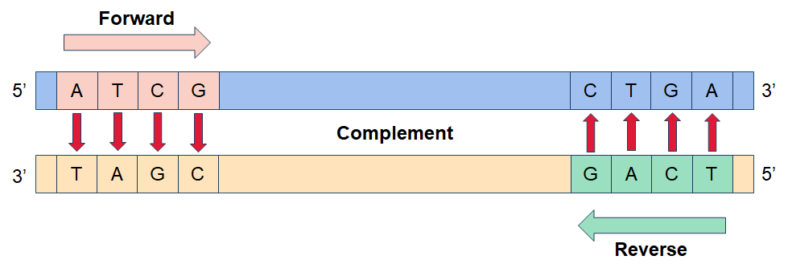
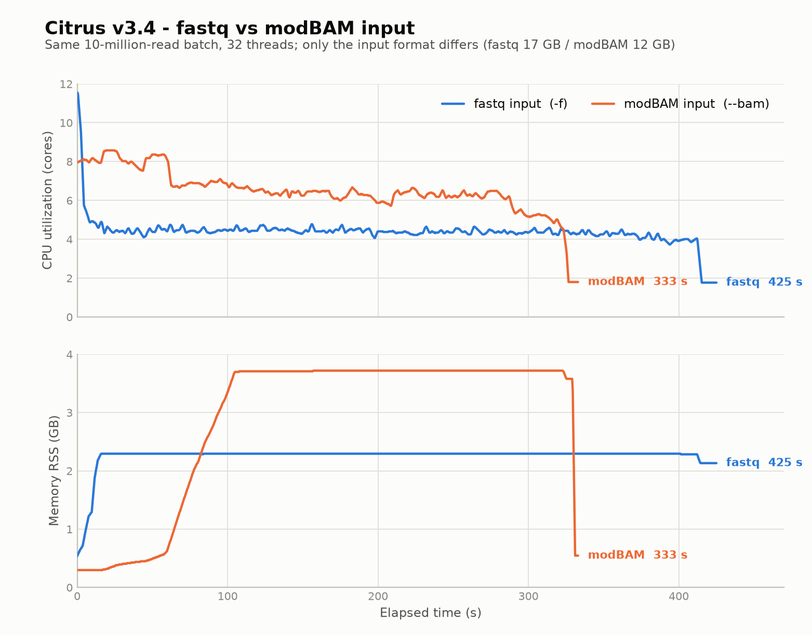
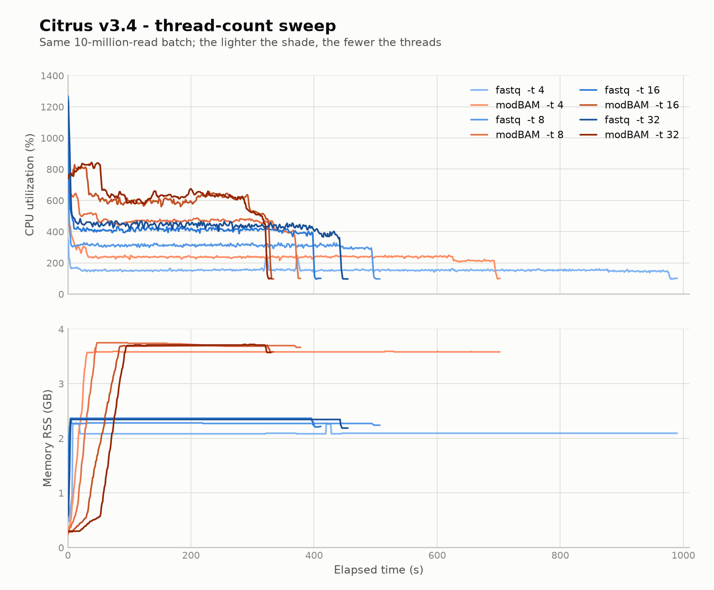

# Citrus

[English](README.md) | [简体中文](README.zh-CN.md)

> 本文件是 [English README](README.md) 的中文译本。若两者存在出入，以英文版为准。

本工具用于从测序数据中高效地拆分 barcode，简化基因组数据的预处理流程，提高下游分析的准确性。

## 开箱即用
**解压后即可使用**

本软件以易用为目标，无需复杂的安装流程：将软件包解压到系统中任意位置即可使用。

**使用步骤：**
1. 下载与你的 CPU 架构（`x86_64` 或 `aarch64`）对应的 `.tar.gz` 文件。
2. 解压到目标位置。
3. 运行 `citrus` 即可启动。

发布版二进制以动态链接方式依赖 glibc，要求宿主机 glibc 2.28 及以上（RHEL 8/9、Rocky 8/9、Debian 10+、Ubuntu 20.04+、ARM 服务器）。除此之外不需要任何外部依赖。

## 使用示例
**Mode 1 barcode 拆分**
```bash
citrus -m 1 -f sample.fq.gz -b barcodes.txt -o output_dir -n sample -e 0.2 -s 150,100 -t threads
```
**Mode 2 barcode 拆分**
```bash
citrus -m 2 -f sample.fq.gz -b barcodes.txt -o output_dir -n sample -e 0.2 -s 150,100 -t threads
```
**多个输入文件**
```bash
citrus -m 1 -f sample1.fq.gz sample2.fq.gz -b barcodes.txt -o output_dir -n sample
```
**BAM 输入**
接受携带 MM/ML 标签的未比对 BAM 文件；其他所有标签原样透传。
```bash
citrus -m 1 --bam sample.bam -b barcodes.txt -o output_dir -n sample
```
**预定义 barcode kit**
```bash
citrus -m 2 -f sample.fq.gz -k CycloneSEQ_24_Barcode_Library_Prep_Set -o output_dir -n sample
```

## 命令行参数
| 参数 | 说明 | 必需 | 默认值 |
| :---: | --- | :---: | :---: |
| `-m, --mode` | 设置 barcode 拆分模式。1：拆分 5' 端 barcode，若识别到 3' 端 barcode 则一并拆分；2：同时拆分 5' 和 3' 两端的 barcode | 是 | - |
| `-f, --fastq` | 输入一个或多个 fastq 文件，以空格分隔 | 是¹ | - |
| `--bam` | 输入一个或多个携带 MM/ML 标签的未比对 BAM 文件，以空格分隔 | 是¹ | - |
| `-k, --kits` | 使用预定义 barcode kit，与 `-b` 互斥 | 是² | - |
| `-b, --barcode` | 输入一个或多个 barcode 文件。若一条 read 两端都有 barcode，请在输入文件中用制表符分隔；当两端的 barcode 互为反向互补时，只需提供 5' 端 barcode；若一条 read 的一端有两个 barcode，barcode 文件中的序列应以逗号分隔 | 是² | - |
| `-n, --sample` | 样本名 | 是 | - |
| `-t, --thread` | 线程数 | 否 | 4 |
| `-o, --outdir` | 输出目录 | 是 | - |
| `-q, --testseq` | 输入测试序列文件 | 否 | - |
| `-L, --min_len` | 短于最小长度的序列在读取输入时即被丢弃：不写入任何文件，也不计入统计。v3.3.0 之前，这类 read 会写入 `{sample}.length_filtered.fq.gz` | 否 | 0 |
| `-Q, --min_qual` | 由碱基质量计算（`-10·log10(mean(10^(-Q_i/10)))`，而非 read ID 中的 qscore）得到的 read 质量低于该阈值的 read 会被丢弃 | 否 | 7.0 |
| `-e, --err` | Levenshtein Distance 阈值（整数）或测序错误率阈值（0 到 1 之间的小数）。当 5' 端和 3' 端使用不同阈值时，用逗号分隔两个数值 | 否 | 0.2,0.2 |
| `-s, --shift` | 用于识别 barcode 序列的截取长度阈值。当 5' 端和 3' 端使用不同阈值时，用逗号分隔两个数值 | 否 | 150,100 |
| `-u, --trim_len` | 3' 端测序不完整时，为识别 barcode 而设置的裁剪长度 | 否 | 0 |
| `-c, --seed_size` | seed 大小 | 否 | 6 |
| `-d, --step_size` | 步长 | 否 | 1 |
| `-r, --retain` | 在 read 上保留 barcode 序列 | 否 | - |
| `-g, --degenerate` | 允许 barcode 和引物中包含简并碱基 | 否 | - |
| `-i, --intermediate` | 输出中间结果 | 否 | - |
| `-F, --filter_chimeric` | 过滤嵌合体 read | 否 | - |
| `-a, --append` | 追加到已有输出文件，而不是覆盖 | 否 | - |
| `-h, --help` | 打印帮助 | 否 | - |
| `-V, --version` | 打印版本 | 否 | - |

¹ `--fastq` 与 `--bam` 必须指定其一，两者互斥。
² `--barcode` 与 `--kits` 必须指定其一，两者互斥。

**关于默认值：** 使用 `-k` 指定预定义 kit 时，kit 调优后的参数会取代上表中的默认值。命令行中显式设置的参数始终优先。

## Barcode 文件
barcode 文件必须包含两列或三列，以制表符分隔：`ID`、`5' 端 barcode 序列`，以及可选的 `3' 端 barcode 序列`。`ID` 可以是 barcode 编号，也可以是样本名、物种名、组织名等名称。此外，一个 `ID` 可以对应多组 barcode 序列。
如下例所示，若 `ID` 为 `BC1`，barcode 文件内容如下：
<table><tr><td>BC1</td><td>ATCG</td><td>TCAG</td></tr></table>



**单端 barcode** —— 每行一个 barcode，两端使用同一序列：

```
barcode_id	barcode_sequence
BC01	ATCGATCG
BC02	GCTAGCTA
```

**双端 barcode** —— 每行两个 barcode：

```
barcode_id	5p_barcode	3p_barcode
BC01	ATGC	GGTA
BC02	TTGCATCA	CCTAGGTA
```

当 5' 和 3' 接头不同时，把同一 barcode ID 的两个接头写在同一个行。Citrus 会自动识别该接头对的两个测序方向。例如：

```
BC01	ATGC	GGTA
```

该配置可匹配如下正向 read：

```
5' ATGC ... TACC 3'
```

其中 `TACC` 是 `GGTA` 的反向互补序列。它也能匹配相反方向：

```
5' GGTA ... GCAT 3'
```

其中 `GCAT` 是 `ATGC` 的反向互补序列。两种方向的 read 都会写入 `BC01` 的输出。如果要求 5' 和 3' 接头都必须检出，请使用 `--mode 2`；如果允许仅凭 5' 接头对 read 分类，请使用 `--mode 1`。

**避免镜像配对。** 如果 5' 和 3' 接头取自同一个共享池，并且列出了所有组合，那么 `(i, j)` 与 `(j, i)` 两种配对是重复的：

```
barcode_id	5p_barcode	3p_barcode
LB1_LB1	ATCGATCG	ATCGATCG
LB1_LB2	ATCGATCG	GCTAGCTA
LB2_LB2	GCTAGCTA	GCTAGCTA
LB2_LB1	GCTAGCTA	ATCGATCG
```

Citrus 会识别每个接头对的两种测序方向，因此 `LB1_LB2` 和 `LB2_LB1` 的匹配规则完全相同。一条 read 两端各带一个接头，接头对 `ATCGATCG` / `GCTAGCTA` 与镜像配对 `GCTAGCTA` / `ATCGATCG` 无法区分，于是两个 ID 的 read 都会写入按名称排序在前的那个 ID，镜像 ID 保持为空。程序不会给出任何警告。

> **注意。** 只列出两种顺序中的一种，例如所有 `i <= j` 的组合（N 个 barcode 对应 N(N+1)/2 个 ID：24 个 barcode 的 pool 为 300 个，96 个 barcode 的 pool 为 4656 个）。这样任一方向的 read 都会归到该 ID 下。
>
> 列出全部组合还会让每个 5' 接头在多个 ID 中重复出现，导致一条 read 得到多个同样好的 5' 候选。在 `--mode 1` 下，这会禁用「仅凭 5' 接头分类」的兜底逻辑，3' 接头匹配不上的 read 会作为 LD-filtered 被丢弃。这种布局请使用 `--mode 2`。

## 预定义 Barcode Kit
使用 `-k` 代替 `-b`，即可用内置 barcode kit 进行拆分：

| Kit | 别名 | barcode 数量 |
| :---: | --- | :---: |
| `CycloneSEQ_24_Barcode_Library_Prep_Set` | `24_Ligation_Barcodes` | 24 |
| `CycloneSEQ_96_Barcode_Library_Prep_Set` | `96_Ligation_Barcodes` | 96 |
| `CycloneSEQ_Rapid_24_Barcode_Library_Prep_Set` | - | 24 |

每个 kit 都带有一套调优后的参数，使用 `-k` 时这些值就是**实际生效的默认值**；不使用 `-k`（自定义 `-b` 文件）时，生效的是上文参数表中的独立默认值。显式设置的参数始终优先于这两者。三个 kit 的参数集合相同：

| 参数 | kit 值（`-k` 下生效） | 独立默认值（`-b` 下生效） |
| :--- | :---: | :---: |
| `--err` | `0.25,0.25` | `0.2,0.2` |
| `--shift` | `150,100` | `150,100` |
| `--seed_size` | 6 | 6 |
| `--step_size` | 1 | 1 |
| `--min_len` | 0 | 0 |
| `--min_qual` | 7.0 | 7.0 |
| `--trim_len` | 6 | 0 |

两套默认值唯一的区别是更宽松的错误阈值（`--err`），以及 3' 端测序不完整时为识别 barcode 而裁剪 6 bp（`--trim_len`）。注意 `--help` 显示的始终是独立默认值，并不是 `-k` 模式下的实际生效值。

## 拆分原理
Citrus 采用 **seed-and-extend（种子定位 + 扩展）** 策略：先用快速的 k-mer 匹配缩小 barcode 可能出现的位置，再用 Levenshtein 编辑距离（LD）比对确认精确位置。因此 barcode 不必与 read 完全一致——测序错误和小片段插入缺失只要在 `--err` 阈值内都可以容忍。

两端 barcode 碱基被切除后，read 才会写入对应 barcode 的输出：

```
5' ATGC ... insert ... TACC 3'   →   insert
   └ barcode ┘            └ 3' barcode, reverse-complemented ┘
```

1. **种子索引** —— 每个 5' barcode 按 `--seed_size` 长度（步长 `--step_size`）切成重叠的 k-mer，存入哈希表，把每个 k-mer 映射到包含它的 barcode。索引只构建一次，被所有 worker 线程共享。
2. **种子匹配与聚类** —— 用相同的 k-mer 窗口扫描 5' 端前 `--shift` 个碱基。按 barcode 收集命中位置并聚类；在同一个密集簇中命中数最多的 barcode 成为候选，来自重复区或偶然相似性的零散命中会被剔除。
3. **编辑距离验证** —— 对每个候选 barcode，在其种子簇附近的小窗口内做半全局 Levenshtein 比对，得到精确的编辑距离和 barcode 结束坐标。距离在 `--err` 阈值内（可以是绝对 LD，也可以是 barcode 长度的比例）时候选通过。
4. **3' 端** —— 末尾 `--shift` 个碱基以同样的方式匹配；3' barcode 在该处以反向互补形式出现。`--mode 2` 要求两端都匹配。`--mode 1` 下，若未找到 3' barcode，则仅按 5' barcode 分类；若找到，则两端都切除。
5. **切除与输出** —— 匹配到的 barcode 碱基被切除（除非指定 `--retain`），插入片段写入该 barcode 的输出。任何一步被拒绝的 read 进入 `Discarded/` 下对应的文件。

由于编辑距离步骤只在种子簇附近的小窗口内运行，每条 read 的比对开销受 `--shift` 限制，不会随 read 长度增长。启用 `-F/--filter_chimeric` 时，Citrus 还会扫描 5' barcode 切除后剩余的插入片段；若出现第二个密集的 barcode 种子区域，就把该 read 标记为嵌合体。

## 输出
```
output/
├── {sample}_{barcode_id}/
│   ├── {sample}_{barcode_id}_01.fastq.gz            # 拆分后的 read
│   └── {sample}_{barcode_id}_01.fastq.stats.tsv     # 每个 barcode 的 read/碱基计数
├── Discarded/
│   ├── {sample}.length_filtered.fq.gz               # 长度过滤的 read
│   ├── {sample}.qval_filtered.fq.gz                 # 质量过滤的 read
│   ├── {sample}.ld_filtered.fq.gz                   # 编辑距离过滤的 read
│   └── {sample}.chimeric.fq.gz                      # 嵌合体 read
├── Intermediate_results/                            # (with -i)
│   ├── {sample}.splitted_record.tsv
│   ├── {sample}.ld_filtered_record.tsv
│   └── {sample}.chimeric_record.tsv
├── {sample}_demux.stats.txt                         # 详细统计
├── {sample}_barcodes.stats.tsv                      # 每个 barcode 的统计表
└── {sample}.barcode_cumulative.json                 # 累计 JSON 摘要
```

BAM 输入时，拆分输出和丢弃输出使用 `.bam` 扩展名而非 `.fastq.gz`/`.fq.gz`，每个 barcode 的统计文件名为 `{sample}_{barcode_id}_01.bam.stats.tsv`。

### 拆分输出与丢弃的 read
`{sample}_{barcode_id}_01.fastq.gz` 保存分配给该 barcode 的 read，为标准 FASTQ 格式（每条 read 四行），gzip 压缩。默认会从 read 两端切除 barcode 序列；`--retain` 会将它们保留在输出中。

`Discarded/` 下的四个文件收集未能归入任何 barcode 的 read，每个类别一个文件：

| 文件 | 包含的 read |
|---|---|
| `{sample}.length_filtered.fq.gz` | 通过 `--min_len`，但因其他长度原因被丢弃（短于最长 barcode，或切除后没有剩余插入片段）；自 v3.3.0 起，该文件不再包含短于 `--min_len` 的 read |
| `{sample}.qval_filtered.fq.gz` | 由碱基质量计算得到的 read 质量（平均错误概率换算回 Q，而非 read ID 中的 qscore）低于 `--min_qual` |
| `{sample}.ld_filtered.fq.gz` | 在 `--err` 阈值内没有匹配到任何 barcode |
| `{sample}.chimeric.fq.gz` | 被检测为嵌合体的 read；只有使用 `-F` 时才会检出该类别，否则文件为空 |

不使用 `-F` 时，嵌合体 read 不会被检出，会留在其匹配到的 barcode 的拆分输出中。

### `{sample}_{barcode_id}_01.fastq.stats.tsv`
位于每个 barcode 子目录中，是一个 TSV 文件，包含一行表头和一行数据：

```
TotalReadNum	TotalBaseNum	PassBaseNum
{read_count}	{base_count}	{pass_base_count}
```

| 列 | 含义 |
|--------|---------|
| `TotalReadNum` | 分配给该 barcode 的 read 数（与下文的 `Read_count` 相同） |
| `TotalBaseNum` | 这些 read 的总碱基数，按原始 read 长度计算 |
| `PassBaseNum` | 切除 barcode 后剩余的碱基数（与下文的 `Passed_base_count` 相同） |

`TotalReadNum` 和 `TotalBaseNum` 不受 `--retain` 影响；`PassBaseNum` 受影响，使用 `--retain` 时等于 `TotalBaseNum`。这些数值是累计值，即包含之前用 `-a` 追加的运行。丢弃类别没有子目录，也不会生成该文件。

### `{sample}_barcodes.stats.tsv`
每个 barcode 一行的 TSV 表：一行表头，之后每个分类成功的 barcode 一行。丢弃类别不列出。行按 barcode ID 的自然顺序排序——连续数字按数值比较，因此 `barcode2` 排在 `barcode10` 之前。

**普通模式（默认）的列：**

| 列 | 含义 |
|--------|---------|
| `Barcode` | barcode ID |
| `Read_count` | 分配给该 barcode 的 read 数 |
| `Base_count` | 该 barcode 的总碱基数，按原始 read 长度求和 |
| `Passed_base_count` | 切除后保留序列的总碱基数 |
| `Read_N50` | 按切除后 read 长度分布计算的 N50 |
| `Read_mean_Q` | 该 barcode 的平均 read Q，取自每条 read ID 中的 Q 值，在错误率空间按 read 碱基数加权平均（保留两位小数）。ID 中无法解析出 Q 的 read 会被排除；若该 barcode 的所有 read 都不带 Q，则值为 `0.00` |

**准确度模式（`-q`）在上述 6 列之后追加 8 列：**

| 列 | 含义 |
|--------|---------|
| `True_read_count` | 验证为正确分类的 read 数 |
| `False_read_count` | 验证为错误分类的 read 数 |
| `Short_read_count` | 过短而无法验证的 read 数 |
| `Chimeric-I_read_count` | 由种子密度检出的嵌合体 read 数 |
| `Chimeric-II_read_count` | 由两条测试序列匹配检出的嵌合体 read 数 |
| `Unknown_read_count` | 未知/未确定的 read 数 |
| `Accuracy(%)` | `True_read_count` 占已验证 read 的百分比 |
| `Index_hopping_rate(%)` | `False_read_count` 占已验证 read 的百分比 |

**`--retain` 对该文件的影响：** `Read_count` 和 `Base_count` 不变；`Passed_base_count` 和 `Read_N50` 增大，因为它们基于 barcode 切除后的序列计算，而 `--retain` 会保留这段序列。

### `{sample}_demux.stats.txt`
纯文本格式的完整统计报告，由三部分组成：

1. **每个 barcode 的表格**：列与 `{sample}_barcodes.stats.tsv` 相同（准确度模式下包含准确度列），按相同的自然顺序排序。
2. **类型 / Read / Base 汇总表**：跨 barcode 的合计，每个类别一行，包含 read 数、碱基数及其占总量的百分比：

   | 行 | 含义 |
   |-----|---------|
   | `Total` | 全部 read / 碱基 |
   | `Demultiplexed_count` / `Demultiplexed_percentage` | 成功分配到一个 barcode |
   | `Length-filtered_count` / `Length-filtered_percentage` | 长度过滤 |
   | `Qval-filtered_count` / `Qval-filtered_percentage` | 质量过滤 |
   | `LD-filtered_count` / `LD-filtered_percentage` | 编辑距离过滤 |
   | `Chimeric-filtered_count` / `Chimeric-filtered_percentage` | 嵌合体过滤 |
   | `CV` | 各 barcode 之间 read / 碱基计数的变异系数 |

   准确度模式会追加 `Accuracy(%)` 和 `Index_hopping_rate(%)` 两行。
3. **Barcode 分布矩阵**（仅准确度模式）：以真实 barcode 为行、预测 barcode 为列的混淆矩阵，展示 index hopping 的流向。行和列遵循与 barcode 表格相同的自然 ID 顺序。

### `{sample}.barcode_cumulative.json`
累计 JSON 摘要，**仅在普通模式下生成**（准确度模式不生成）。顶层字段：

| 字段 | 含义 |
|-------|---------|
| `run_total_passed_reads` / `run_total_passed_bases` | 通过 QC 的 read / 碱基总数 |
| `run_classified_reads` / `run_classified_bases` | 已分类的 read / 碱基计数 |
| `run_unclassified_reads` / `run_unclassified_bases` | 未分类（丢弃）的 read / 碱基计数 |
| `run_classified_reads_rate` / `run_classified_bases_rate` | 对应比例 |
| `run_unclassified_reads_rate` / `run_unclassified_bases_rate` | 对应比例 |
| `run_barcode_cumulatvie_info` | 数组，每个 barcode 一项 |

`run_barcode_cumulatvie_info` 中的每一项描述一个 barcode：

| 字段 | 含义 |
|-------|---------|
| `barcode_id` | barcode ID |
| `sequence` | 该 ID 注册的 barcode 序列 |
| `reads` / `bases` | 该 barcode 的 read 数和碱基数 |
| `reads_rate` / `bases_rate` | 该 barcode 占已分类 read / 碱基的比例 |
| `split_rate` | 保留字段，目前恒为 `0.0` |
| `reads_q_val` | 该 barcode 的众数 read Q |
| `total_reads_base` | 切除 barcode 后剩余的碱基数 |
| `N50` | 切除后 read 长度分布的 N50 |
| `q_bins` / `q_counts` | read 质量直方图：分箱边界（80.0 到 100.0，步长 0.1）及各分箱内的 read 数 |

该文件支持通过 `-a` 跨多次运行累计。

### `Intermediate_results/`（使用 `-i`）
三个 TSV 文件，每个包含一行表头和每条 read 一行：

| 文件 | 列 |
|------|---------|
| `{sample}.splitted_record.tsv` | `Record_ID`、`Barcode_ID`、`LD_of_5_end`、`End_pos_of_5_end`、`Seed_match_pos`、`LD_of_3_end`、`End_pos_of_3_end` |
| `{sample}.ld_filtered_record.tsv` | `Record_ID`、`Barcode_ID`、`LD`、`Seed_match_pos` |
| `{sample}.chimeric_record.tsv` | `Record_ID`、`Seed_count_per_win` |

这些文件用于单条 read 的可视化与问题排查。

## 性能
以下数据来自对同一批 **1000 万条 read** 的基准测试，使用 Citrus v3.4 拆分。除特别说明外，各次运行的版本、barcode 文件和所有参数完全一致，只改变输入格式或线程数。

### 输入格式：fastq 与 modBAM
同一批 read 拆分两次：一次从 17 GB 的 fastq 文件（`--fastq`），一次从等价的 12 GB modBAM 文件（`--bam`），均使用 32 线程。

| 输入 | 耗时 | 平均 CPU | 峰值内存 |
|---|---|---|---|
| fastq（`-f`） | 425 s | 4.4 核 | 2.3 GB |
| modBAM（`--bam`） | 333 s | 6.5 核 | 3.7 GB |



modBAM 输入比 fastq 输入大约**快 20% 到 30%**，拆分输出等价。提速来自更高的并行度，而并行度差异源于输入解码方式。modBAM 侧的 MM/ML 标签重算实测开销可以忽略，不是性能瓶颈。

### 线程数扩展性
同样的 1000 万条 read 分别用 4、8、16、32 线程拆分。

| 线程数 | fastq | modBAM |
|---|---|---|
| 4 | 990 s | 702 s |
| 8 | 507 s | 378 s |
| 16 | 411 s | 334 s |
| 32 | 455 s | 330 s |



CPU 利用率随请求线程数非线性增长。超过 16 线程后基本不再提升：fastq 运行甚至变慢（32 线程 455 s，对比 16 线程的 411 s），modBAM 运行仅再快 4 s。

## 常见问题

### 1. `--mode 1` 和 `--mode 2` 有什么区别？

两种模式定位 5' barcode 的方式完全相同，对于找到 3' barcode 的 read，结果也一致。区别只在于**没找到 3' barcode** 时的处理。

| | `--mode 1` | `--mode 2` |
|---|---|---|
| 5' barcode | 必需 | 必需 |
| 3' barcode | 可选 | 必需 |
| 未匹配到 3' barcode 的 read | 仅按 5' barcode 分类 | 作为 LD-filtered 丢弃 |
| 切除 | 找到 3' barcode 时切除两端，否则只切除 5' 端 | 总是切除两端 |

`--mode 1` 兜底逻辑的两个细节：

- 只有当 5' 端归属唯一时才生效，即恰好只有一个 barcode 具有最小编辑距离。若多个 barcode 并列，read 会像 `--mode 2` 一样作为 LD-filtered 丢弃。这正是 [Barcode 文件](#barcode-文件) 中「列出全部组合」的布局不能用于 `--mode 1` 的原因：同一个 5' 接头被多个 ID 共享，5' 端归属永远不唯一。
- 仅按 5' barcode 分类时，3' 端**不会**被切除。因此输出 read 仍带有该端测到的序列。

**如何选择：** 两端都保证存在时（双端 index 文库、双端 barcode kit）使用 `--mode 2`。3' 端经常缺失、截断或不可靠时使用 `--mode 1`。`--mode 1` 能拆分 `--mode 2` 能拆分的所有 read，外加只带可用 5' barcode 的 read，因此拿不准时它是更稳妥的选择——但多出来的 read 仅凭 5' barcode 就被接受。

### 2. 如何把目录下全部（或部分）FASTQ/BAM 文件传给 `--fastq`/`--bam`？

`--fastq` 和 `--bam` 接受一个或多个明确的文件路径，以空格分隔。Citrus 本身既不遍历目录也不展开通配符——展开由 shell 完成，因此直接使用 shell 通配符即可：

```bash
# 目录下所有 FASTQ
citrus -m 1 -f /data/run1/*.fq.gz -b barcodes.txt -o out -n sample

# 带编号的文件，按序号顺序展开（bash 花括号展开）
citrus -m 1 -f /data/run1/sample_{1..10}.fq.gz -b barcodes.txt -o out -n sample

# 选定的子集
citrus -m 1 -f /data/run1/A.fq.gz /data/run1/B.fq.gz -b barcodes.txt -o out -n sample

# 目录下所有 BAM
citrus -m 1 --bam /data/run1/*.bam -b barcodes.txt -o out -n sample

# 递归包含子目录（sort -z 保证顺序确定）
find /data -name '*.fq.gz' -print0 | sort -z | xargs -0 citrus -m 1 -b barcodes.txt -o out -n sample -a -f
```

注意事项：

- **不要给通配符加引号。** 加了引号的 `"*.fq.gz"` 会原样传给 Citrus，并以 `No such file or directory` 报错。通配符完全没有匹配到文件时也一样——先用 `ls` 确认。
- **第一个文件必须可读。** 无法打开时整次运行中止。列表中靠后的文件无法打开时只会给出警告并跳过，运行继续处理其余文件——请留意日志中的 `Warning: failed to open ...`。
- **不要传目录。** Citrus 期望的是文件，传目录会导致运行失败。
- **`xargs` 可能把过长的文件列表拆成多次 Citrus 运行。** 它默认串行执行，因此多次运行不会重叠——但每次运行都写入同一个输出目录并覆盖上一次写入的内容，只有最后一批会保留。上面的示例因此传入了 `--append`，让各批结果累加；注意把同一条命令再次运行到同一目录会再追加一次。追加要求每次运行使用相同的 barcode 集合和相同的 `--shift` 阈值，否则 Citrus 会报错退出。**不要**加 `-P`（并行）：多个 Citrus 进程写同一个输出目录会损坏输出的 FASTQ/BAM 文件和 `.summary.bincode` 文件。
- **文件按给定顺序读取**，并拼接成单一的 read 流。`find` 返回的是目录顺序而非排序后的结果，因此需要确定顺序时请通过 `sort -z`（自然顺序用 `sort -zV`，`sample_2` 排在 `sample_10` 之前）处理。注意线程数大于 1 时 read 由并行 worker 写出，输出文件内的顺序本来就不是输入顺序。
- `--fastq` 与 `--bam` 互斥；两者都有时请分两次运行。

**带编号的文件集。** 在 bash 中，`{1..10}` 会在通配符解析之前展开为十个独立参数，因此 `sample_{1..10}.fq.gz` 变成 `sample_1.fq.gz` … `sample_10.fq.gz`。有两点值得注意：

- 文件按**序号顺序**（1、2、……、10）读取。单纯的 `*` 通配符则按字典序排列，会把 `sample_10` 紧接在 `sample_1` 之后。顺序不影响结果，只决定 read 进入流程的先后。
- 不存在的文件会把自己的名字留在参数列表里，Citrus 随后会尝试打开这个名字：如果它是第一个文件，运行中止；否则给出警告并跳过。如果需要避免这种情况，请事先剔除空缺：

  ```bash
  files=(); for i in {1..10}; do f=/data/run1/sample_${i}.fq.gz; [ -f "$f" ] && files+=("$f"); done
  citrus -m 1 -f "${files[@]}" -b barcodes.txt -o out -n sample
  ```

花括号展开是 bash/zsh 的特性——POSIX `sh`（dash）不支持，会原样把模式交给 Citrus。

### 3. 为什么输入已经通过长度和质量过滤，仍有一些 read 因长度和质量被过滤？

因为这两个过滤都不是简单地与阈值做一次比较，而且这里使用的 Q 值并不是 read ID 中打印的 qscore。

**长度——`--min_len` 不是唯一的长度过滤。** 另外两种长度原因也会让长度超过 `--min_len` 的 read 进入 `Discarded/{sample}.length_filtered.fq.gz`：

- **短于最长 barcode**（`barcode_len_max`）：这类 read 不可能包含 barcode，因此在匹配前就被丢弃。
- **切除后没有剩余序列**：barcode 位于 read 的最末端，或比对消耗了整条 read（barcode/接头二聚体的典型情况），切除 barcode 后没有插入片段剩余。

该文件中的记录以未切除的形式写出（原始 SEQ/QUAL），因此长度可能超过 `--min_len`——在 "length-filtered" 文件中看到 100 bp 或更长的 read 是正常的。

本身短于 `--min_len` 的 read 行为不同：自 v3.3.0 起，普通模式在读取输入时就会跳过它们，因此它们不会写入任何文件，也不会计入统计（`{sample}_demux.stats.txt` 的 `Total` 行因此可能小于输入记录数）。准确度模式（`--testseq`）没有读取阶段的预过滤；在那里它们会进入 `length_filtered`。如果输入来自之前的一次 Citrus 运行，还有一点需要注意：那次运行的 `--min_len` 检查看到的是未切除的 read，而它的输出是切除后的，因此一条带两个 16 bp barcode 的 132 bp read 在当时以 132 bp 通过了检查，进入本次运行却只有 100 bp（而 100 bp 的 read 进入时只剩 68 bp）。

**质量——read Q 由碱基质量计算，而不是从 read ID 读取。** Citrus 使用整数 QUAL 字符串：

```
read_q = -10 · log10( mean( 10^(-Q_i / 10) ) )
```

对到达时的**整条 read** 计算。read ID 中的 qscore 由 basecaller 写入，遵循另一套口径，且这套口径在 basecaller 版本间发生过变化：

- **旧版本**基于 read 的首尾 chunk 计算，忽略中间部分。
- **当前版本**对长度不低于 100 bp 的 read 忽略首尾 40 bp，否则按全长计算，并采用同样的错误概率公式。

因此这两个量是对不同碱基集合求的平均值；此外 Citrus 基于整数 QUAL（上限 Q40）计算，而 basecaller 使用其内部值。在短 read 上，或中间段质量较低的 read 上，两者可能相差约 ±0.5–1 Q，因此 ID 中显示 `qscore 8` 的 read 仍可能被 `--min_qual 7` 过滤。如果之前的过滤是由其他工具基于 read ID qscore 而非碱基质量执行的，也存在同样的情况。

如果输入来自之前的一次 Citrus 运行，还有一点不同：那次运行的 `--min_qual` 检查针对包含 barcode 的原始 read，而本次运行评估的是切除后的 read；去掉 barcode 碱基可能让边界 read 越过阈值（我们的测试中为 7.44 → 6.69）。

**快速定位一条消失的 read：**

| 这条 read 在哪里 | 被什么过滤了 |
|---|---|
| 任何文件中都没有，且 `Total` 计数偏少 | `--min_len`，在读取阶段应用（普通模式） |
| `Discarded/{sample}.length_filtered.fq.gz` | 通过了 `--min_len`，但短于 `barcode_len_max` 或切除后没有剩余插入片段 |
| `Discarded/{sample}.qval_filtered.fq.gz` | Citrus 计算的 read Q 低于 `--min_qual` |
| `Discarded/{sample}.ld_filtered.fq.gz` | 在 `--err` 内没有匹配到 barcode |

> **注意。** 默认情况下 barcode 会从输出 read 上切除，因此 Citrus 的输出文件无法再用同一套 barcode 拆分：这些 read 会作为 LD-filtered 被丢弃，因为 barcode 已不在其中。如果打算对输出再次运行 Citrus，请在生成输入时使用 `--retain`。

## 作者

Ming Lian 连明 (lianming@genomics.cn)

Jiayuan Zhang 张嘉远 (zhangjiayuan@genomics.cn)

## 许可与使用限制
**仅供研究使用**

本软件严格限于个人研究目的使用，严禁商业使用。具体而言：
**允许：** 个人学术研究、个人学习及非商业性实验。
**不允许：** 任何形式的商业应用、分发，或直接、间接产生收入的使用。包括但不限于集成到商业产品、将本软件作为服务提供，或用于商业获利。

如需商业授权或许可，请联系我们。
